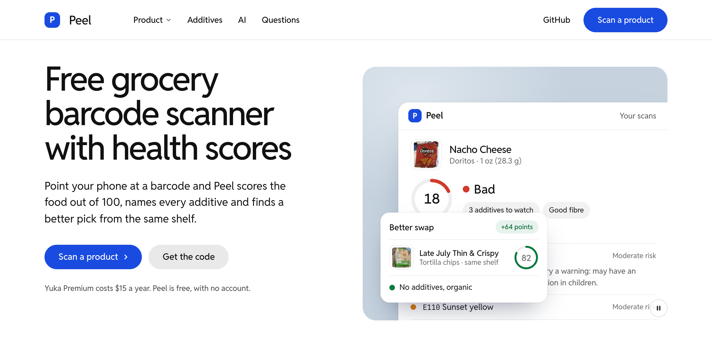
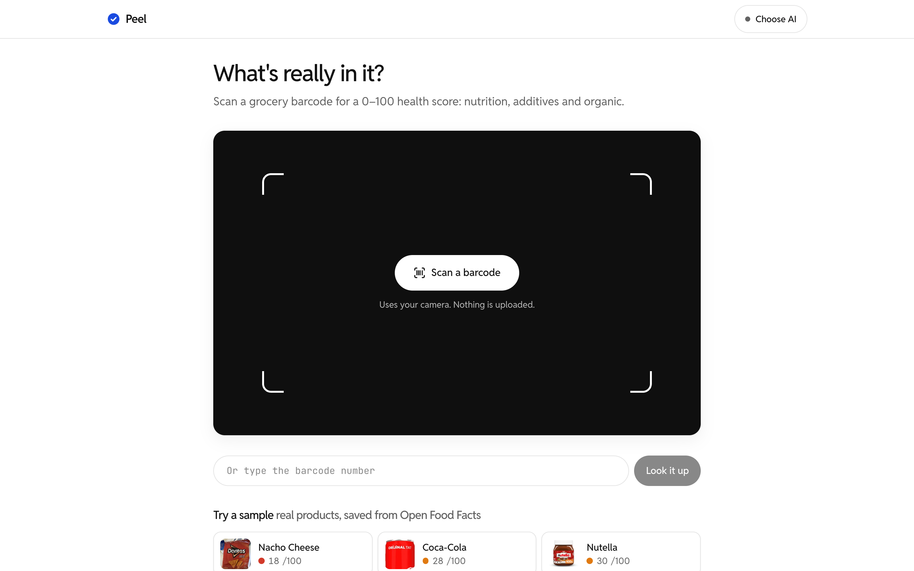
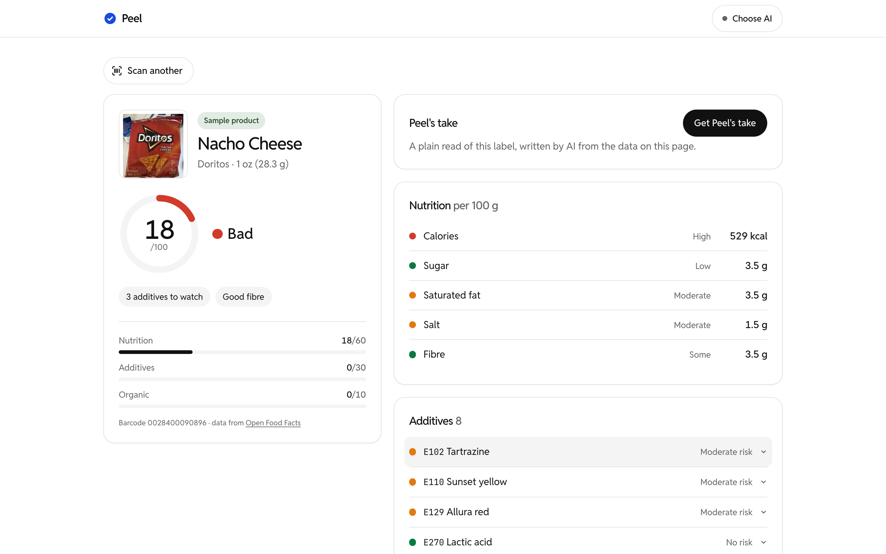
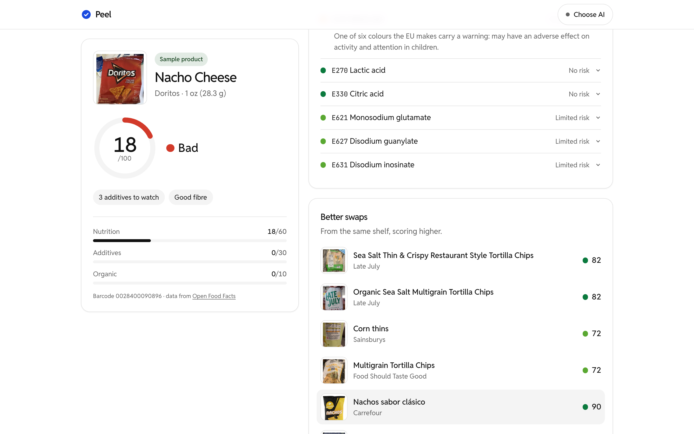
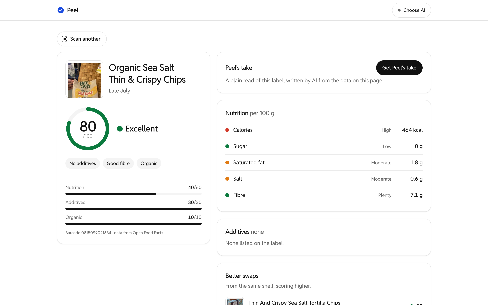

<div align="center">



# Peel

**Scan any grocery barcode and see how healthy it really is**

[**Live app →**](https://peel.vedantsoni.com) &nbsp;·&nbsp; [Watch the demo](docs/media/demo.mp4) &nbsp;·&nbsp; [Report a bug](https://github.com/VedSoni-dev/peel/issues)

[](LICENSE)
[](https://peel.vedantsoni.com)
[](https://github.com/VedSoni-dev/peel/stargazers)

</div>


## What it does

A free, open-source alternative to [Yuka](https://yuka.io) (Premium is $10 to $20 a year). Inspired by it, not affiliated with it.

- **Scan a grocery barcode** with your phone's camera (or type the number) and get a score out of 100: Excellent, Good, Poor or Bad.
- **See why:** sugar, salt, saturated fat and calories per 100 g, with fibre and protein when they help.
- **Tap any additive** (E-number) for its risk level and the reason, from EU warning labels to FDA bans.
- **Find a better swap** from the same shelf: real products that score higher, sold where yours is sold.
- **Get Peel's take:** a short plain-language verdict written by your own AI, and ask follow-ups ("is it OK for kids?").

## Bring your own AI

No account with us. Pick what powers it, and switch any time:

| Mode | How | Works on |
|---|---|---|
| **Claude API key** | Paste your Anthropic key. Stored encrypted on your browser only. | web + your computer |
| **publik** | Sign in with publik and use your publik plan. No key. | web + your computer |
| **ChatGPT plan** | Continue with ChatGPT and use your Plus or Pro plan. No API key. | your computer |
| **Local model** | Ollama or LM Studio on your computer. Free, private, offline. | your computer |

## Run it yourself

```bash
git clone https://github.com/VedSoni-dev/peel.git
cd peel
npm install
npm run dev
```

Open http://localhost:3000. Requires Node 20.9 or newer. Nothing to configure: choose a mode in the app.

## Screenshots

<table>
  <tr>
    <td></td>
    <td></td>
  </tr>
  <tr>
    <td></td>
    <td></td>
  </tr>
</table>

## How it works

Product data comes from [Open Food Facts](https://world.openfoodfacts.org), the open database of food labels (ODbL; product photos CC BY-SA). The barcode is read on your phone with the browser's BarcodeDetector, or the same API from zxing-wasm (served from this app, no CDN). Only the number goes to the server, which asks Open Food Facts and caches the answer for a day.

**The score** uses the split Yuka publishes, with Peel's own maths, all in `lib/score.ts`:

| Part | Points | How |
|---|---|---|
| Nutrition | 60 | From the 2023 Nutri-Score number: food A ≤ 0 → about 50 points, E ≥ 19 → under 14 (drinks on their own scale) |
| Additives | 30 | Minus 8 per moderate-risk additive, minus 2 per limited one. A high-risk additive sets this to 0 **and caps the whole score at 49** |
| Organic | 10 | An official organic label (USDA, EU and others) |

Bands: Excellent 75+, Good 50+, Poor 25+, Bad under 25. The additive table (`lib/additives.ts`, about 180 E-numbers) is Peel's own reading of public positions (EFSA re-evaluations, the EU's warning label for six colours, IARC classifications, FDA decisions); an additive not in it is shown as "not rated" and costs nothing. Swaps come from Open Food Facts' search: the same category, graded A or B, scoring higher than yours. Scores never use AI; only Peel's take does.

| Path | What |
|---|---|
| `app/route.ts`, `lib/landing.ts` | The landing page (static HTML on `public/assets`) |
| `app/app/page.tsx`, `components/` | The app: scanner, score, additives, Peel's take, swaps |
| `lib/score.ts`, `lib/additives.ts` | The score and the additive table |
| `lib/off.ts`, `app/api/product`, `app/api/swaps` | Open Food Facts lookups and swaps |
| `lib/samples.json` | Six real products saved from Open Food Facts, for "Try a sample" |
| `app/api/ai/route.ts` | Peel's take (the prompt lives here) |
| `kit/` | Shared studio kit: the four AI modes, the mode picker, theme and motion tokens |
| `studio.config.ts` | Name, links and which AI modes this app offers |

**Privacy.** The camera picture never leaves your phone; only the barcode number does. Your scan history is kept in your browser (localStorage). Your Claude key is kept in an encrypted, http-only cookie on your browser and sent only to Anthropic. ChatGPT sign-in tokens stay on your computer in `~/.config/peel/` (owner-only). Local models never leave your machine. The app sends an anonymous usage count to [Vedant's builds hub](https://builds.vedantsoni.com) (this app's name, which AI mode answered, a random id per browser; no content, no IP, no account), and never for browsers with Do Not Track or Global Privacy Control.

## Contributing

Issues and pull requests are welcome. For a bigger change, open an issue first so we can talk about it.

## License

[MIT](LICENSE) © Vedant Soni

<div align="center">
<sub>Built in public by <a href="https://instagram.com/vedanttalksai">@vedanttalksai</a>. More builds at <a href="https://vedantsoni.com">vedantsoni.com</a>.</sub>
</div>
